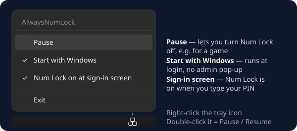
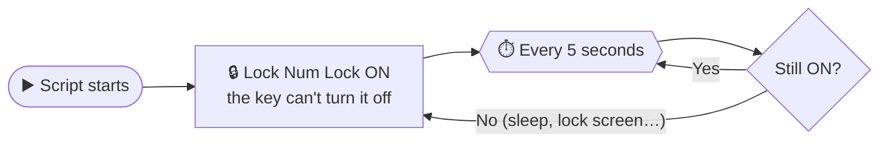

# 🔢 AlwaysNumLock


**Never type arrows instead of numbers again.** AlwaysNumLock keeps your keyboard's `Num Lock` switched **ON**, no matter what.

<p align="center">
  
</p>

---

## ✨ What it does

| Situation | Without the script | With AlwaysNumLock |
|:--|:--:|:--:|
| You bump `Num Lock` by accident | ❌ turns OFF | ✅ stays ON |
| PC wakes up from sleep / hibernate | ❌ often OFF | ✅ ON |
| You return from the lock screen | ❌ sometimes OFF | ✅ ON |
| Typing your PIN at the sign-in screen | ❌ sometimes OFF | ✅ ON *(one-time option)* |
| Need the number pad as arrows for a game? | — | ⏸️ **Pause** from the tray |
| CPU / memory use | — | 🪶 practically zero |

---

## 🚀 Get started

### ⚡ Easiest: download the .exe (no AutoHotkey needed)

```
 ① Download AlwaysNumLock.exe   →   ② Double-click it   →   ✅ Num Lock stays ON
```

1. Go to **[Releases](https://github.com/mogdho/AlwaysNumLock/releases/latest)** and download **`AlwaysNumLock.exe`**.
2. **Double-click** it and click **Yes** on the admin pop-up.
   A **1-2-3 keys icon** appears in your system tray: done! 🎉

> 🛡️ **"Windows protected your PC"?** The .exe isn't code-signed (that costs money), so Windows SmartScreen may warn you. Click **More info** → **Run anyway**. Don't trust it? Use the script version below and read the code yourself.

### 🛠️ Or run the script with AutoHotkey

1. **Install [AutoHotkey v2](https://www.autohotkey.com/)** (free).
2. **Download** this repository: green **Code** button → **Download ZIP**, then unzip it.
3. **Double-click** `Numlock.ahk` and click **Yes** on the admin pop-up.
   A **1-2-3 keys icon** appears in your system tray: done! 🎉

On the first run it asks whether Num Lock should also be **on at the Windows sign-in screen**. Click **Yes** if you type a numeric PIN. You can change this later from the tray menu.

> **Why admin?** Without it, Windows lets the `Num Lock` key through while an admin app (Task Manager, installers…) is in front. It's also needed for the sign-in screen option.

---

## 🗂️ Tray menu

Right-click the tray icon:

<p align="center">
  
</p>

| Option | What it does |
|:--|:--|
| **Pause** | Stops the lock so you can turn Num Lock off (e.g. for a game). The icon fades. *Tip: double-click the tray icon to pause / resume.* |
| **Start with Windows** | Starts the script automatically when you log in, **with no admin pop-up**. Click again to turn it off. |
| **Num Lock on at sign-in screen** | Turns Num Lock on before you log in, so your PIN works first time. |
| **Exit** | Closes the script. |

> 💡 If you move the script to another folder, just tick **Start with Windows** again.

---

## 🧠 How it works



1. **Locks it:** `SetNumLockState "AlwaysOn"` makes the `Num Lock` key do nothing.
2. **Safety net:** every 5 seconds it checks the light. If Windows switched it off (e.g. after sleep), it locks it ON again.
3. **Sign-in screen:** the option sets Windows' own `InitialKeyboardIndicators` registry value, which Windows reads before anyone logs in.

> ℹ️ If Num Lock is still off at the sign-in screen after a full shutdown, turn off **Fast Startup** (Control Panel → Power Options → *Choose what the power buttons do*), or turn on Num Lock in your PC's BIOS.

---

## 🗑️ Uninstall

1. Right-click the tray icon → **untick Start with Windows** *(removes its startup task)*.
2. *(Optional)* **untick Num Lock on at sign-in screen** to give Windows back its default.
3. Right-click the tray icon → **Exit**.
4. Delete `AlwaysNumLock.exe` / `Numlock.ahk` and `AlwaysNumLock.ini` next to it.

> ⚠️ **Already deleted it?** The startup task is left behind. Press `Win + R` → `taskschd.msc` → right-click **AlwaysNumLock (AutoHotkey)** → **Delete**.

---

### 🔗 Download / Source
- 📂 **Repository:** [github.com/mogdho/AlwaysNumLock](https://github.com/mogdho/AlwaysNumLock)

### 👨‍💻 Author
**Mogdho Paul** · [github.com/mogdho](https://github.com/mogdho)
